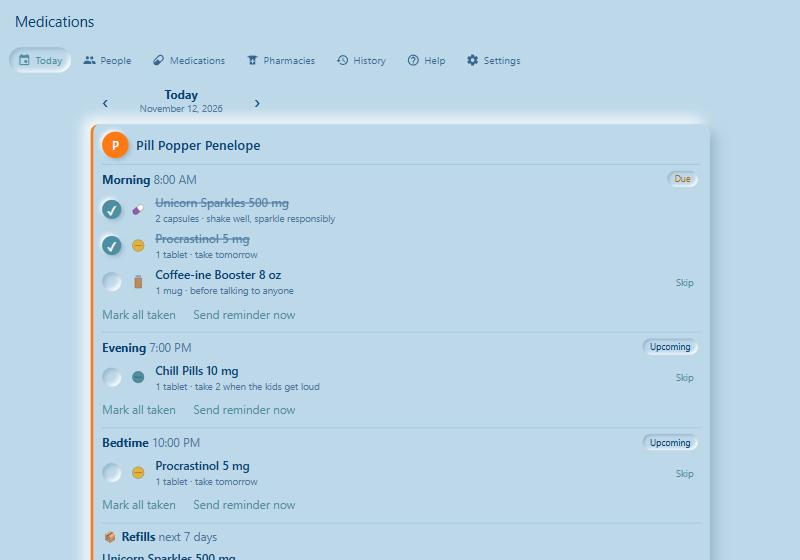
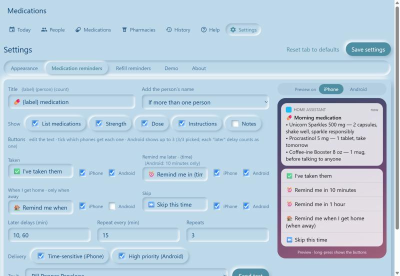
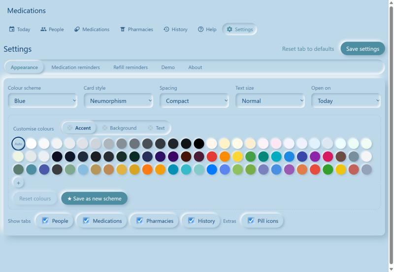

# Medications for Home Assistant

A friendly medication app inside Home Assistant: who takes what and when, actionable reminders on
your phone, refill reminders, and your pharmacies — all in its own sidebar page.

## What it does

- **Today** — each person's Morning / Evening (or any time) medications. Tap to mark taken, skip, undo.
- **Grouped phone reminders** — everything due at the same time arrives in one notification with buttons:
  *I've taken them*, *Remind me in 10 minutes / 1 hour*, **Remind me when I get home** (only when you're away), *Skip*.
- **Flexible schedules** — every day, certain weekdays, every 2 weeks, monthly (by date or e.g. "2nd Wednesday"), with start and end dates.
- **Refill reminders** — on a calendar you choose (e.g. every 2 weeks on Thursday), repeated daily until you tap
  *Ordered*, *Snooze 1 day* or *Not needed*. *Call pharmacy* opens a screen with the Rx number in big type.
- **Pharmacies** — search nearby or by name (OpenStreetMap + the US pharmacy registry) to fill in address, phone and the account login page.
- **Pause / resume** a medication, look it up (Drugs.com, MedlinePlus, GoodRx), see the history.
- **iPhone and Android** — each phone gets its own version; pick which 3 buttons Android shows.
- **Your look** — colour schemes, Neumorphism / Glassmorphism, custom colours, saved schemes.
- **Setup wizard** with a practice mode, a **demo person** with silly medications, and a built-in Help tab.
- **Backups** — nightly copies of all Medications data (kept 14 days) with one-tap restore, plus export/import to a file.

| | |
|---|---|
|  |  |

## Install

1. **Add the repository to HACS (Marketplace):**

   

   Then **Download**, and **restart Home Assistant** when asked.

2. **Add the integration:**

   

   (or Settings → Devices & services → Add integration → **Medications**)

3. Open **Medications** in the sidebar — the **setup wizard** starts automatically.

Manual install

Copy `custom_components/med_manager` into your Home Assistant `config/custom_components/` folder,
restart, then add the integration as in step 2.

## Requirements

- Home Assistant 2026.10 or newer.
- The **Home Assistant Companion app** on each phone that should get reminders.
- For "remind me when I get home": the person in Home Assistant with location tracking.

## Privacy

Everything stays in your Home Assistant. Nothing is sent anywhere except: the pharmacy search sends your
search words and home area to OpenStreetMap / the US NPI registry, and the *Look up* links open those websites.
Passwords are never stored — *Open account login* opens your pharmacy's page for your password manager.

## Not a medical device

This is a convenience tool, not a medical device. Phones, networks and Home Assistant can fail —
don't rely on it as the only reminder for critical medications.

## License

MIT
